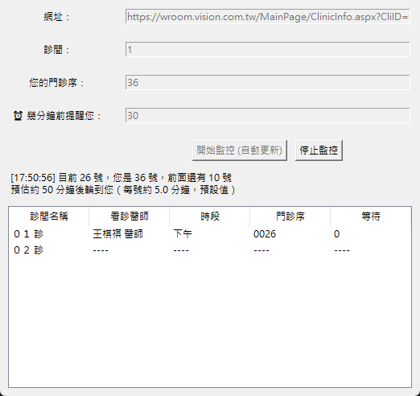

# 全國雲端候診中心 自動提醒

這是一個基於 Python 的自動化工具，用於監控「全國雲端候診中心」的診間狀態，並在指定時間前提醒用戶。用戶只需輸入網址、診間、門診序號以及希望提前幾分鐘提醒，工具會自動監控診間狀態並在時間到時發出提醒。<br>
全國雲端候診中心：https://wroom.vision.com.tw/MainPage.aspx

---

## 功能

- **自動監控診間狀態**：從「全國雲端候診中心」網站獲取診間資訊。
- **自定義提醒時間**：根據用戶輸入的門診序號和提前提醒時間，計算提醒時間。
- **依叫號速度估算**：觀察最近 60 分鐘的叫號速度估算每號所需時間；診間叫號較快時會提早提醒。
- **鬧鈴提醒**：在指定時間觸發鬧鈴，並發送系統通知、還原最小化的視窗、工作列圖示閃爍。
- **斷線自動重試**：網路不穩時持續重試，連續失敗 3 次才提示。
- **記住上次輸入**：自動帶入上次的網址、診間與提前分鐘數。
- **圖形化界面**：使用 `tkinter` 提供簡單易用的圖形化界面。

---

## 使用步驟

1. **輸入網址**：輸入當前診所的全國雲端候診中心的網址<br>
（例如：`https://wroom.vision.com.tw/MainPage/ClinicInfo.aspx?CliID=GFsICcr5K5CFuYtO5Ut06w==`）
2. **輸入診間**：輸入你要監控的診間名稱或代碼<br>
（例如：`1`、`第一`、`01`皆可）
3. **輸入門診序號**：輸入你的門診序號<br>
（例如：`15`）
4. **設置提前提醒時間**：輸入你希望提前幾分鐘提醒<br>
（例如：`30`）。每號所需時間預設為 5 分鐘；監控期間若觀察到叫號較快（至少前進 2 號後開始估算），會改用實際速度計算，最快以每號 1 分鐘計。估算值不會超過 5 分鐘，因此提醒只會提早、不會延後。
5. **開始監控**：點擊「開始監控 (自動更新)」按鈕（或在最後一欄按 Enter），工具每 30 秒更新一次，狀態列會顯示目前叫號與前面還有幾號；快輪到你時會跳出視窗並響鈴。可隨時按「停止監控」。

## 截圖

  
*圖形化界面示例*

---

## 安裝與運行

### 環境需求

- Python 3.8 或更高版本
- Chrome 瀏覽器（用於 Selenium）
- ChromeDriver 不需手動安裝（Selenium 4.6 以上會自動下載對應版本）

### 安裝步驟

1. **複製專案**：
   ```bash
   git clone https://github.com/partner0487/Auto_Doctor_Checker.git
   cd Auto_Doctor_Checker
   ```

2. **安裝需求**：
   ```bash
   pip install -r requirements.txt
   ```

3. **運行專案**：
   ```bash
   python DoctorChecker.py
   ```

### 打包成 exe（Windows）

不想安裝 Python 的使用者可以用打包好的 exe（電腦仍需安裝 Chrome）：

```bash
pip install -r requirements.txt pyinstaller
build_exe.bat
```

產生的檔案為 `dist\AutoDoctorChecker.exe`。

程式圖示的原始檔為 `assets/icon.svg`，修改後執行 `python tools/make_icon.py`（需要 Pillow）重新產生 `icon.png` 與 `icon.ico`。上次輸入的設定存於 `%APPDATA%\AutoDoctorChecker\settings.json`。

---

## 依賴列表

以下是專案所需的 Python 庫（`tkinter` 為 Python 內建，不需另外安裝）：

```plaintext
selenium>=4.6
pygame
word2number
roman
plyer      # 選用：系統通知
```

### 執行測試

```bash
pip install pytest
pytest
```

---

## 貢獻

歡迎提交 Issue 或 Pull Request 來改進此專案！

---

## 授權

此專案採用 [MIT 授權](LICENSE)。

---

## 聯絡資訊

如有任何問題或建議，請聯繫：  
- 電子郵件：partner0487@gmail.com  
- GitHub：[partner0487](https://github.com/partner0487)

---

